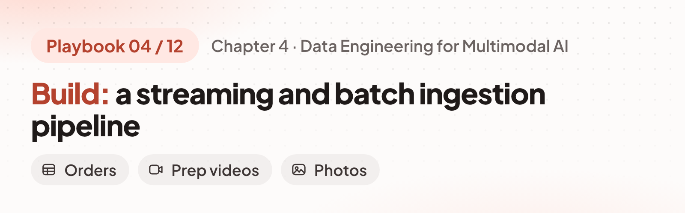
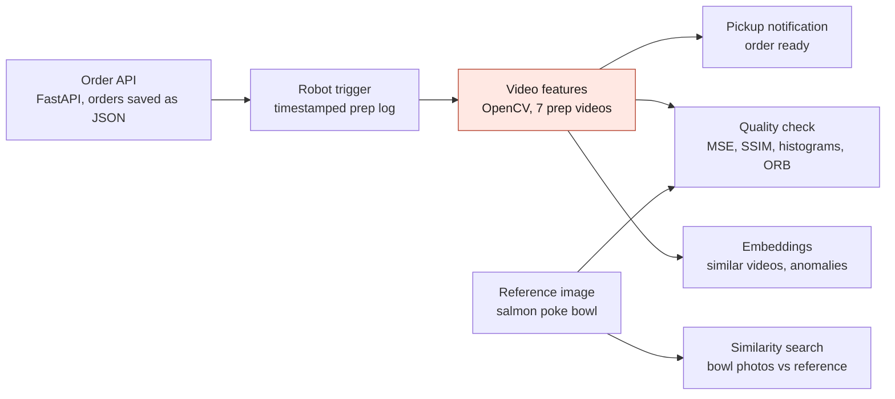

<picture>
  <source media="(prefers-color-scheme: dark)" srcset="docs/img/header-dark.png">
  
</picture>

# Playbook 04: Ingest orders, kitchen videos and food photos in one pipeline
**How to combine streaming and batch ingestion for multimodal data.** Chapter 4 of [*Data Engineering for Multimodal AI*](https://oreil.ly/data-engineering-multimodal) (O'Reilly, 2026), pages 125–133.

[](https://github.com/Data-Engineering-for-Multimodal-AI/playbook-04-multimodal-ingestion-pipeline/actions/workflows/smoke.yml)

[](LICENSE)
[](https://codespaces.new/Data-Engineering-for-Multimodal-AI/playbook-04-multimodal-ingestion-pipeline?quickstart=1)

Orders, kitchen prep videos and food photos arrive at different speeds and in different shapes, and the kitchen has to act on all of them. In this repo, we explore this with ByteEats, a fictional cloud kitchen. Follow along to take orders through an API, extract features from the prep videos, check dish photos against a reference, and combine the results so problems get flagged.

**The problem.** Multimodal data doesn't arrive together: orders come in one at a time, while videos and photos are large files that arrive in batches, each with its own format.

**What you'll work with.** You'll weigh streaming against batch and ETL against ELT, ingest each modality in the way that suits it, validate data at the boundaries, and combine it once it lands.

Bonus content (not printed in the book): [playbook-04-bonus-multimodal-vector-similarity](https://github.com/Data-Engineering-for-Multimodal-AI/playbook-04-bonus-multimodal-vector-similarity).

> Following the book? Its steps are in [Run it the way the book does](#run-it-the-way-the-book-does) and still work as printed. Want the code exactly as printed? Use the `first-edition` tag. This branch is the 2026 maintenance update; see [Differences from the printed book](#differences-from-the-printed-book).

## Run it

You need [uv](https://docs.astral.sh/uv/) and `make`. No Docker, no GPU, no API keys. Or open the repo in a GitHub Codespace, where both are ready. On Windows without `make`, use a Codespace or the book's steps below.

**1. Get the code.** The clone is about 45 MB, including the seven sample videos.

```bash
git clone https://github.com/Data-Engineering-for-Multimodal-AI/playbook-04-multimodal-ingestion-pipeline.git
cd playbook-04-multimodal-ingestion-pipeline
```

**2. Run the whole pipeline.** Installs the locked dependencies (`uv sync`) and runs every step on the sample order (`python ByteEats/run_pipeline.py`): it starts the Order API, sends the sample order, runs the robot trigger, extracts features from the seven videos, sends the pickup notification, runs the quality check, builds the embeddings and runs the similarity search. On a Mac this took 41 s with the dependencies already downloaded.

```bash
make run
```

You should see, among the output of each step:

```
Order ORD1001 is ready for pickup!
Quality check for order ORD1001: FAILED
Overall score: 16.13%
Generated 7 embeddings for order ORD1001
Successfully completed 7/7 steps.
```

The quality check fails on purpose: the last packaging frame is a side view and the reference is a top-down photo (see [Expected output](#expected-output)). The outputs are in `orders/`, `processed_orders/`, `robot_logs/`, `video_features_enhanced/`, `qa_results/`, `video_embeddings/` and `similarity_results/`.

**3. Send your own order.** Starts the Order API on port 8000 (`python ByteEats/api/order_api.py`). Leave it running.

```bash
make serve
```

In a second terminal, send an order and read it back. This is a `POST /api/orders`, then a `GET /api/orders/<order_id>`:

```bash
make order ITEM="Miso Salmon Bowl"
```

```
POST /api/orders -> HTTP 200 {"order_id":"ORD6213","status":"received","message":"Order received successfully"}
GET /api/orders/ORD6213 -> {"restaurant_id": "PH001", ..., "menu_item": "Miso Salmon Bowl", ..., "order_status": "received"}
```

The order ID is random. Now hand the order to the robot (step 2 of the book):

```bash
uv run python ByteEats/services/robot_trigger.py --once
```

```
robot-trigger - INFO - Processing order ORD6213
robot-trigger - INFO -   → Robot action: initialize_robot (0.5s)
robot-trigger - INFO -   → Robot action: grab_scoop (1.0s)
...
robot-trigger - INFO - Order ORD6213 processed and moved to processed_orders/ORD6213.json
```

A "Miso Salmon Bowl" gets the generic bowl sequence; only a salmon poke bowl gets the salmon-cutting steps. Change `ITEM=` and look at `robot_logs/`. The interactive API docs are at http://localhost:8000/docs. Stop the API with Ctrl+C.

**4. Find similar videos.** Ranks the sample videos by cosine similarity of their embeddings to one video (`python ByteEats/analysis/embedding_generator.py similar`). Needs step 2's output.

```bash
make similar VIDEO=salmon-prep-1
```

```
    "video_path": "salmon-prep-3.mp4",
    "similarity": 0.9804775890573619
    "video_path": "salmon-prep-4.mp4",
    "similarity": 0.9770871652902404
    "video_path": "salmon-prep-2.mp4",
    "similarity": 0.8890608745642891
```

The three closest are the other prep videos. `VIDEO=` takes any name in `ByteEats/data/sample-videos/` without `.mp4`. [Try this 2](#try-this) shows why these scores are all so high.

**5. Clean up.**

```bash
make clean
```

This deletes the folders the pipeline writes (`orders/`, `processed_orders/`, `robot_logs/`, `video_features*/`, `notification_logs/`, `qa_results/`, `video_embeddings/`, `embedding_models/`, `similarity_results/`). The sample data and `.venv/` stay.

## How much time do you have?

| Time | What to do |
|---|---|
| 15 minutes | [Run it](#run-it), steps 1 to 4. On a Mac, step 2 took 41 s. |
| 1 hour | The three [Try this](#try-this) experiments (about a minute together on a Mac), then open `qa_results/ORD1001_comparison.jpg` and `video_embeddings/ORD1001_embeddings_viz.png` to see what the quality check and the embeddings compared. |
| 1 day | [Use your own data](#use-your-own-data): run the pipeline on your own order and videos, then work through [Before production](#before-production). |

## Try this

Each experiment changes one thing and measures the effect. None of them needs Docker or a network. The numbers below are from a Mac on 2026-11-21; times vary with the machine and its load.

**1. How many frames should ingestion sample per video?** The extractor samples 12 evenly spaced frames from each 8-second clip, and infers robot actions from motion thresholds. This runs the same code with 4 to 24 frames.

```bash
make try-frame-sampling
```

```
frames    time  average motion  ingredients differ  actions differ
     4    3.2s          30.30%            0 of 7        0 of 7
     8    7.8s          24.57%            0 of 7        1 of 7
    12   12.8s          21.10%            0 of 7        0 of 7
    24   25.9s          15.14%            0 of 7        3 of 7
```

Time grows with the number of frames, because each frame is a seek in the video. Motion is measured between consecutive sampled frames, so more frames mean smaller gaps and lower motion. The thresholds were set for 12 frames: at 24, `delivery-packaging-7` loses `complete_packaging`, and the notification service would then report the order as not ready. Change `FRAME_COUNTS` in `experiments/frame_sampling.py`, or make the motion thresholds depend on the time between frames.

**2. Does scaling the features change which videos look alike?** Each video's vector mixes color and motion percentages (0 to 100) with 0/1 flags for the stage and the ingredients, and the pipeline compares the raw values. This compares them raw and standardized (each feature to mean 0, standard deviation 1). Needs step 2's output.

```bash
make try-feature-scaling
```

```
features                      lowest  highest  pairs above 0.8
raw (as the pipeline does)     0.159    0.980         9 of 21
standardized                  -0.682    0.789         0 of 21

video                    nearest, raw             nearest, standardized
salmon-prep-2            salmon-bowl-assembly-5   salmon-prep-3
...
Largest raw features (mean over videos): container blue % 31.5, motion max % 31.1, motion mean % 21.1; ...
```

Raw, the large percentages decide the similarity, and 9 of the 21 pairs clear the anomaly threshold of 0.8. Standardized, `salmon-prep-2`'s nearest video is another prep video instead of the assembly video. The anomaly check's 0.8 threshold only means something for one scaling; `StandardScaler` is created in `embedding_generator.py` but never used.

**3. Which bad orders get through the Order API?** Sends one good and seven bad orders to `POST /api/orders` and hands each saved order to the robot trigger, then checks the same requests against a stricter schema defined in the experiment. It runs in a temporary folder.

```bash
make try-order-validation
```

```
request                         API (as is)  robot prepared  stricter schema
good order                         accepted             yes         accepted
quantity 0                         accepted             yes         rejected
quantity -2                        accepted             yes         rejected
no items                           accepted             yes         rejected
blank menu item                    accepted             yes         rejected
dish not on the menu               accepted             yes         rejected
5,000-character instructions       accepted             yes         rejected
quantity as text                   accepted             yes         rejected

total accepted                       8 of 8          8 of 8           1 of 8
```

The API checks only that the fields exist and have roughly the right types, so every bad order reaches the robot. The stricter schema (`StrictOrderInput`) adds a minimum and maximum quantity, at least one item, a fixed menu and a length limit. Move those checks into `OrderInput` in `ByteEats/api/order_api.py` and the API answers HTTP 422 instead.

## Use your own data

Put one order in a folder:

```
my_order/
  order.json          the order as you would POST it to /api/orders, plus "order_id"
  videos/             .mp4 clips of the order being made. The file name says the stage:
                      salmon-prep-<n>, assembly, quality-check, packaging or delivery
  reference_images/   optional: a photo of the finished dish, named after the menu item
                      (miso_salmon_bowl.jpg for "Miso Salmon Bowl"); .jpg, .jpeg or .png
```

```json
{"order_id": "ORD2001", "restaurant_id": "PH001", "restaurant_name": "Sample Poke Bar",
 "menu_item": "Miso Salmon Bowl", "items": [{"name": "Salmon", "quantity": 1}],
 "order_placed_at": "2026-11-21T12:30:00"}
```

Without `reference_images/`, the quality check looks in `ByteEats/data/reference_images/`, which has only the salmon poke bowl. Check the folder first. This reads every file and writes nothing:

```bash
make check-data DIR=my_order
```

It reports every problem with the file and the reason, and stops if there is any. On a test folder with deliberately bad files:

```
9 problem(s) in bad_order; nothing was written:
  order.json: restaurant_id: Field required
  order.json: order_id: needs 1-40 letters, digits, - or _ (it becomes a file name)
  order.json: items.0.quantity: must be 1 or more, got 0
  order.json: order_placed_at: not an ISO 8601 time: 'yesterday noon'
  videos/kitchen-cam.mp4: the name doesn't say the stage (salmon-prep-<n>, assembly, quality-check, packaging or delivery)
  videos/quality-check.mp4: not an MP4 video (no MP4 header)
  videos/salmon-prep-3.mp4: a Git LFS pointer, not a video (run git lfs pull)
  videos/salmon-prep-4.mov: not an .mp4 file (the extractor reads only .mp4)
  reference_images/salmon_poke_bowl.jpg: can't open as an image
```

It also checks for an empty file, a video with fewer than two readable frames or no frame rate, an image smaller than 32x32, a missing menu item, an empty item list, the sample order's ID `ORD1001`, and that there is a packaging or assembly clip for the quality check. When everything passes, run the pipeline on it:

```bash
make load DIR=my_order
```

This extracts the features into `video_features_enhanced/<order_id>/`, runs the quality check against your reference image, builds the embeddings, and compares each video with the same stage in the other orders in `video_embeddings/` (the sample order, after `make run`). On a test folder built from four sample clips, one of them an assembly clip renamed `salmon-prep-2.mp4` (10 s on a Mac):

```
my_order: order ORD2001 (Miso Salmon Bowl), 4 videos (assembly, packaging, prep), reference image from my_order/reference_images/. All checks passed.
Extracted features from 4 videos into video_features_enhanced/ORD2001/ (log: video_features_enhanced/ORD2001/extract.log)
Quality check: FAILED, overall score 15.66% (pass mark 70%), report qa_results/ORD2001_quality_report.json
Compared with the same stage in 1 other order(s) (embedding_generator.py anomalies, threshold 0.8):
  bowl-assembly.mp4            assembly  similarity 1.000  ok
  delivery-packaging.mp4       packaging similarity 1.000  ok
  salmon-prep-1.mp4            prep      similarity 0.907  ok
  salmon-prep-2.mp4            prep      similarity 0.843  ok
```

The mislabeled clip scores 0.843 against the real prep videos and passes the anomaly check: with raw features, almost everything is above 0.8 ([Try this 2](#try-this)). `make clean` deletes these outputs too.

## What you end up with

A pipeline that takes an order through an API, a robot service, video feature extraction, a quality check and vector embeddings, and runs on your own orders and videos after checking them.

Skills you'll practice:
- Ingesting an order stream through an API and batch video files from a folder
- Sampling frames from video and turning them into numeric features
- Validating orders and media files before they enter the pipeline
- Comparing images and videos with similarity scores, and reading what the scores mean
- Scaling features before you compare them
- Measuring how a sampling or schema choice changes the results

## Before production

This playbook runs on one machine with sample data. Before you run something like it for real:

1. **Validate orders where they enter.** `OrderInput` accepts a quantity of 0 or -2, an empty item list and dishes the kitchen doesn't make; all 8 test orders reached the robot ([Try this 3](#try-this)). Reject them at the API with HTTP 422. *Chapter 4, "What Happens When Validation Fails" (page 120).*
2. **Replace folder polling with a queue.** The robot trigger polls `orders/` every 2 seconds and the notification service every 5, and an order is "taken" by renaming its file. Two workers can pick the same order, and a failure leaves no retry. *Chapter 2, "Streaming Ingestion" (page 48); Chapter 8, "Streaming and Batch Ingestion" (page 282).*
3. **Tie thresholds to time, not to a frame count.** The robot actions come from motion thresholds that only hold for 12 sampled frames; at 24 frames, the packaging video loses `complete_packaging` ([Try this 1](#try-this)). *Chapter 4, "Balancing Cost, Latency, and Fidelity" (page 118).*
4. **Scale features before comparing them.** The embeddings are raw features padded with zeros to 128 values, and 9 of 21 video pairs score above the 0.8 anomaly threshold. An assembly clip filed as a prep clip scored 0.843 and was not flagged ([Use your own data](#use-your-own-data)). *Chapter 5, "Feature-Engineering Core Techniques" (page 143).*
5. **Don't take the stage from the file name.** `identify_video_type` reads the stage from words in the file name, so a misnamed clip is processed as the wrong stage. Carry the stage and the order ID as metadata from the robot that recorded the clip. *Chapter 4, "Annotation: Where Multimodal Systems Mature or Collapse" (page 123).*
6. **Keep each order's outputs apart.** The extractor writes frames to `video_features_enhanced/<video name>/`, so a second order with the same video names overwrites the first order's frames, which its quality report still points to. `make load` writes to a folder per order for this reason. *Chapter 4, "Observability: Tracing Signals Through the Pipeline" (page 122).*
7. **Compare like with like in the quality check.** The reference is a top-down photo and the packaging frame a side view, so the sample order scores 16.13% and fails, and so would every order. Take the reference with the same camera, or check the dish with a model. *Chapter 4, "Validation, Transformation, Observability, and Annotation Across Modalities" (page 119).*
8. **Store vectors in a vector database.** Embeddings are a pickle file per order, and `similar` and `anomalies` open every file on each call. *Chapter 6, "Vector Databases" (page 180).*
9. **Lock down the API.** It listens on all interfaces with no authentication, and `GET /api/orders/{order_id}` returns customer IDs and instructions to anyone. *Chapter 11, "Protecting Data Across the Pipeline" (page 421).*

## What it costs

| Where you run it | Cost |
|---|---|
| Your machine | $0. Everything runs locally: no API keys, no paid services. The environment is about 415 MB. |
| A GitHub Codespace (2 cores, 8 GB, the default size; this repo asks for no larger one) | Estimated $0.18 per hour at GitHub's list price (November 2026). A free personal account includes 120 core-hours a month, about 60 hours on this machine. In CI, `make run` took 30 s in a freshly built devcontainer, and the whole job, building the container included, 1 min 19 s. |

## How it works



```
┌─────────────┐    ┌─────────────┐    ┌─────────────┐    ┌─────────────┐
│   Order     │    │   Robot     │    │   Video     │    │   Quality   │
│  Ingestion  │─→  │ Preparation │─→  │  Feature    │─→  │  Assurance  │
│             │    │             │    │ Extraction  │    │             │
└─────────────┘    └─────────────┘    └─────────────┘    └─────────────┘
                                                               │
                                                               ▼
                                      ┌─────────────┐    ┌─────────────┐
                                      │ Similarity  │    │   Vector    │
                                      │   Search    │←─  │ Embeddings  │
                                      │             │    │             │
                                      └─────────────┘    └─────────────┘
```

The pipeline has six stages, plus a pickup notification once the order is packaged:

1. **Order Ingestion** (`ByteEats/api/order_api.py`): a FastAPI service that receives orders and saves them as JSON.
2. **Robot Preparation** (`ByteEats/services/robot_trigger.py`): picks up new orders and simulates the robot's preparation sequence, with a timestamped log.
3. **Video Feature Extraction** (`ByteEats/extractors/enhanced_extractor.py`): samples frames from the seven preparation videos with OpenCV and records colors, edges, motion, likely ingredients and robot actions.
4. **Quality Assurance** (`ByteEats/analysis/quality_checker.py`): compares the last packaging frame with a reference image (MSE, SSIM, color histograms, ORB keypoints).
5. **Vector Embeddings** (`ByteEats/analysis/embedding_generator.py`): turns each video's features into a vector, then finds similar videos and anomalies.
6. **Similarity Search** (`ByteEats/analysis/similarity_demo.py`): ranks bowl images by visual similarity to the reference.
7. **Pickup Notification** (`ByteEats/services/notification.py`): marks the order ready for pickup once the packaging video shows it's done.

Everything runs on a laptop CPU with the bundled sample data: no cloud account, no GPU, no network after installation.

## Run it the way the book does

These are the book's steps (pages 125–133), as printed apart from the fixes listed in [Differences from the printed book](#differences-from-the-printed-book). [Run it](#run-it) above runs the same pipeline with `make`.

You need Python 3.12 or newer and about 450 MB of disk space for the environment.

### 1. Clone the repository

```bash
git clone https://github.com/Data-Engineering-for-Multimodal-AI/playbook-04-multimodal-ingestion-pipeline.git
cd playbook-04-multimodal-ingestion-pipeline
```

### 2. Create and activate a virtual environment

```bash
python -m venv .venv
source .venv/bin/activate  # On Windows: .venv\Scripts\activate
```

### 3. Install dependencies

```bash
pip install -r requirements.txt
```

The versions are pinned. Using [uv](https://docs.astral.sh/uv/) instead: `uv sync`, then prefix the Python commands below with `uv run` (or run `make pipeline`).

### 4. Create necessary directories

```bash
mkdir -p orders processed_orders robot_logs video_features_enhanced notification_logs qa_results video_embeddings
```

This step is optional now: each script creates the folders it writes to.

### Run the pipeline step by step

Run these from the repository root, in this order. The outputs go to the folders above.

**1. Start the Order API** (in its own terminal; it runs until you press Ctrl-C):

```bash
python ByteEats/api/order_api.py
```

The API will start on http://localhost:8000.

**2. Process a sample order** (in a second terminal):

```bash
curl -X POST "http://localhost:8000/api/process-sample-order"
```

**3. Run the Robot Trigger Service:**

```bash
python ByteEats/services/robot_trigger.py --once
```

`--once` processes the waiting order and exits. The printed command, without `--once`, still works: it keeps watching `orders/` for new orders until you press Ctrl-C.

**4. Extract video features:**

```bash
python ByteEats/extractors/enhanced_extractor.py
```

It reads the seven videos in `ByteEats/data/sample-videos/`. Use `--video-dir`, `--output-dir` and `--order-id` to point it elsewhere.

**5. Send the pickup notification:**

```bash
python ByteEats/services/notification.py --once
```

Like the robot service, it polls until Ctrl-C without `--once`.

**6. Run quality checks:**

```bash
python ByteEats/analysis/quality_checker.py ORD1001 "Salmon Poke Bowl"
```

**7. Generate vector embeddings:**

```bash
python ByteEats/analysis/embedding_generator.py generate ORD1001
```

The same script finds the videos most similar to one video, and flags videos that differ from the rest of the order:

```bash
python ByteEats/analysis/embedding_generator.py similar ByteEats/data/sample-videos/salmon-prep-1.mp4 --top 3
python ByteEats/analysis/embedding_generator.py anomalies ORD1001 --threshold 0.8
```

**8. Run the similarity search demo:**

```bash
python ByteEats/analysis/similarity_demo.py
```

Stop the Order API with Ctrl-C when you're done.

### Run the complete pipeline

```bash
python ByteEats/run_pipeline.py
```

This runs every step in sequence and prints a summary. It starts the Order API itself (and stops it at the end) unless one is already running on port 8000, so you don't need step 1 first. It takes about 20 seconds and exits with code 1 if any step fails.

### Other scripts

- **Script names printed in the book (pages 127–132).** The scripts at the repository root (`byteats_order_api.py`, `robot_trigger_service.py`, `pickup_notification_service.py`, `video_feature_extractor.py`, `enhanced_video_extractor.py`, `image_quality_checker.py`, `video_embedding_generator.py`, `image_similarity_demo.py`) run the matching `ByteEats/` module with the same arguments, so `python image_quality_checker.py ORD1001 "Salmon Poke Bowl"` still works.
- **Basic extractor.** `python ByteEats/extractors/video_extractor.py` is the simpler extractor; it writes to `video_features/`.
- **TensorFlow (optional, untested).** `advanced_video_extractor.py` detects objects with an SSD MobileNet v2 model from TensorFlow Hub, and `embedding_generator.py` uses the Universal Sentence Encoder if TensorFlow is installed. Neither is part of the tested pipeline, and `requirements.txt` doesn't install TensorFlow. To try them: `pip install tensorflow tensorflow-hub` (TensorFlow 2.21 supports Python 3.12 and 3.13). The `tfhub.dev` model links now resolve to Kaggle Models; Google states `hub.load()` still accepts them. Without TensorFlow, the embedding generator prints "TensorFlow not available. Using fallback embedding method." and uses the video features directly.

### Checks

```bash
make smoke    # or: uv run pytest -q
```

`make smoke` (about a minute on a laptop CPU) checks the sample data, the Order API, each step's output and exit code, the root wrappers, and `run_pipeline.py` end to end. GitHub Actions runs it on Python 3.12 and 3.13, plus the printed `pip install -r requirements.txt` path with `run_pipeline.py`.

`uv run pytest -q tests/test_own_data.py` checks the file checks behind `make check-data` (a few seconds). `make order`, `make similar`, `make check-data` and `make load`: see [Run it](#run-it) and [Use your own data](#use-your-own-data).

## Tested on

| | |
|---|---|
| Date | 2026-10-23 |
| OS | macOS 26.5.1 (arm64); GitHub Actions `ubuntu-latest` |
| Python | 3.12.15 and 3.13.16 |
| Key packages | opencv-python-headless 5.0.0.93, numpy 2.5.4, scikit-learn 1.9.1, matplotlib 3.11.2, fastapi 0.161.1, pydantic 2.14.1, uvicorn 0.54.0 |
| Install time | `pip install -r requirements.txt`: 16 s (environment 415 MB) |
| Pipeline | `python ByteEats/run_pipeline.py`: about 21 s from a fresh clone |

Every command above was run from a fresh clone of this branch on 3.12. The extracted video features are identical to a run of the first-edition code with its original pinned versions (OpenCV 4.8, NumPy 1.26).

## Differences from the printed book

The "First edition" column is the code and README at the `first-edition` tag, which the book describes.

| What | First edition | Now | Why |
|---|---|---|---|
| Clone URL and folder | `github.com/yourusername/ByteEats` | `playbook-04-multimodal-ingestion-pipeline` | The repository's actual location |
| Python | 3.9+ | 3.12+ | Current dependencies. The 2023 pins didn't install on Python 3.13 |
| Video extraction (step 4) | Crashed: it read `sample-data/sample-prep-cycle-end-to-end/sample-prep-cycle`, which isn't in the repository | Reads `ByteEats/data/sample-videos` | Bug. Its `--video-dir`, `--output-dir` and `--order-id` options were also ignored; they work now |
| `video_extractor.py`, `advanced_video_extractor.py` | `SyntaxError` (`global` after use); never ran | Fixed | Bug |
| Quality check result | `PASSED`, overall score 72.30% | `FAILED`, overall score 16.13% | The SSIM term was computed on 8-bit pixels and overflowed to 1.92 (the valid range is -1 to 1), which supplied about 67 of the 72.30 points. Computed correctly, SSIM is 0.31: the last packaging frame is a side view and the reference is a top-down photo. Identical images still score 100% |
| Robot trigger and notification services | Polled forever | `--once` processes what's waiting and exits; without it they poll as before | So the steps, the complete pipeline and the tests can finish |
| `run_pipeline.py` | Hung at step 2; needed the API already running and `curl` | Finishes; starts and stops the API itself; exits 1 on failure | The services never exited, and it ran them in `ByteEats/` while the API wrote to `./orders` |
| Pickup notification | Not in the README's step list (the book has it, page 129) | Step 5 | `run_pipeline.py` already ran it |
| Embedding t-SNE plot | Never written (a warning in the log) | `video_embeddings/ORD1001_embeddings_viz.png` | t-SNE's default perplexity (30) must be below the number of videos (7) |
| Similarity figure | Showed the first three images in the folder | Shows the three most similar | Bug |
| Exit codes | 0 even when the input was missing | 1 when the quality check or embedding step can't run | So failures are visible |
| Duplicate files | Eight scripts and two image folders existed both at the root and in `ByteEats/` | One copy in `ByteEats/`; the root scripts are wrappers with the old names | The copies were identical. The code read the root images; it now reads `ByteEats/data`, which the README documented |
| `setup.py`, `setup_github.sh`, empty files `#` and `On` | Present | Removed | `pyproject.toml` replaces `setup.py`; the GitHub helper set up a new repository under a placeholder account |
| OpenCV | `opencv-python` 4.8 | `opencv-python-headless` 5.0 | OpenCV 5.0 was released in June 2026; the code uses no window functions, and the results are identical |
| Pydantic | `order.dict()` | `order.model_dump()` | `.dict()` is deprecated in Pydantic 2 |
| Sample order's restaurant | "Poke House" | "Sample Poke Bar" | The sample named a real restaurant chain; the playbook uses fictional businesses |
| `docs/images/`, `tests/` in the project tree | Listed, but missing | `tests/` added; `docs/images/` removed from the tree | Accuracy |

Details are in [CHANGELOG.md](CHANGELOG.md).

## Data and licenses

| Files | Source | License |
|---|---|---|
| `ByteEats/data/sample-videos/*.mp4` (7 videos) | Created by the author with a Google generative video model | MIT |
| `ByteEats/data/reference_images/`, `ByteEats/data/sample_bowls/` (6 images) | Created by the author with the same model; two are frames from the videos | MIT |

None of it shows a real restaurant, kitchen, robot or person. [ByteEats/data/README.md](ByteEats/data/README.md) lists every file and what uses it.

The full list, with sources, licenses and citations, is in [DATA_SOURCES.md](DATA_SOURCES.md).

## Expected output

From `python ByteEats/run_pipeline.py` and the step-by-step commands in a fresh clone, 2026-10-23, macOS 26.5.1 (arm64), Python 3.12.15. Log timestamps are trimmed. This is the output of this version; it may differ from the output printed in the book, and that's okay.

**Step 3, robot trigger:**

```
robot-trigger - INFO - Found 1 orders to process
robot-trigger - INFO - Processing order ORD1001
robot-trigger - INFO - Triggering robot prep for order ORD1001
robot-trigger - INFO -   → Robot action: initialize_robot (0.5s)
robot-trigger - INFO -   → Robot action: grab_knife (1.2s)
robot-trigger - INFO -   → Robot action: cut_salmon (2.5s)
robot-trigger - INFO -   → Robot action: portion_salmon (1.0s)
robot-trigger - INFO -   → Robot action: grab_scoop (0.8s)
robot-trigger - INFO -   → Robot action: place_rice (1.5s)
robot-trigger - INFO -   → Robot action: add_salmon (1.0s)
robot-trigger - INFO -   → Robot action: add_seaweed (0.7s)
robot-trigger - INFO -   → Robot action: add_sauce (0.5s)
robot-trigger - INFO -   → Robot action: finalize_bowl (1.3s)
robot-trigger - INFO - Robot preparation complete. Log saved to robot_logs/ORD1001_robot_log.json
robot-trigger - INFO - Order ORD1001 processed and moved to processed_orders/ORD1001.json
```

**Step 4, video features** (one block per video; the first is shown, then the per-video results):

```
Found 7 videos to process
Processing video: delivery-packaging-7.mp4
  Extracted 12 frames over 8.00s
  Primary frame analysis: salmon_red:8.71%, salmon_orange:45.26%, sauce_brown:47.31%, rice_white:9.17%
  Edge density: 3.74%
  Average motion: 11.14%
  Video type: packaging, Stage: 0
  Detected ingredients: salmon, sauce
  Inferred robot actions: grab_container, complete_packaging
Features saved to video_features_enhanced/delivery-packaging-7_features.json
```

| Video | Average motion | Detected ingredients | Inferred robot actions |
|---|---|---|---|
| delivery-packaging-7 | 11.14% | salmon, sauce | grab_container, complete_packaging |
| quality-check-visual-6 | 22.53% | salmon, rice, seaweed, sauce | scan_bowl, measure_weight, verify_appearance, verify_ingredients |
| salmon-bowl-assembly-5 | 29.66% | salmon, rice, seaweed, sauce, container | initialize_assembly, place_rice, add_salmon, add_seaweed, add_sauce |
| salmon-prep-1 | 20.64% | container | initialize_robot, grab_knife, position_knife |
| salmon-prep-2 | 25.16% | container | position_salmon, begin_cutting |
| salmon-prep-3 | 21.93% | container | cut_salmon, portion_salmon |
| salmon-prep-4 | 16.62% | container | complete_salmon_prep, transfer_to_assembly |

The ingredient detection is color thresholding, so it is approximate: on the prep videos, the edge density is high enough to report a container but no ingredient color covers enough of the frame.

**Step 5, pickup notification:**

```
pickup-notification - INFO - Checking 1 orders for pickup readiness
pickup-notification - INFO - Checking pickup status for order ORD1001
pickup-notification - INFO - Order ORD1001 is ready for pickup!
pickup-notification - INFO - Sending pickup notification for order ORD1001 to customer CUST7890
pickup-notification - INFO - Order ORD1001 marked as ready for pickup
```

**Step 6, quality check:**

```
image-quality-checker - INFO - Checking quality for order ORD1001 (Salmon Poke Bowl)
image-quality-checker - INFO - Loading reference image: <repository>/ByteEats/data/reference_images/salmon_poke_bowl.jpg
image-quality-checker - INFO - Using packaging final frame: video_features_enhanced/delivery-packaging-7/frame_11.jpg
image-quality-checker - INFO - Quality check for order ORD1001: FAILED
image-quality-checker - INFO - Overall score: 16.13%
image-quality-checker - INFO - Quality report saved to qa_results/ORD1001_quality_report.json
```

The report's metrics (each scaled to 100): SSIM 31.17, ORB feature score 25.40, histogram correlation 0.70, MSE score 0.01. The pass threshold is 70%. The comparison image is `qa_results/ORD1001_comparison.jpg`.

On Linux x86-64 (GitHub Actions, both Python versions) the score is 16.41%: the video frame decodes slightly differently there (MSE 15,105 against 15,125), which moves the ORB feature score to 26.20 and the histogram correlation to 1.30. The check fails either way.

**Step 7, embeddings:**

```
video-embeddings - INFO - Embeddings visualization saved to video_embeddings/ORD1001_embeddings_viz.png
video-embeddings - INFO - Generated 7 embeddings for order ORD1001
TensorFlow not available. Using fallback embedding method.
{
  "success": true,
  "order_id": "ORD1001",
  "embeddings_count": 7,
  "embeddings_file": "video_embeddings/ORD1001_embeddings.pkl"
}
```

**Step 8, similarity search:**

```
Processing 7 images...
Similarity matrix saved to similarity_results/similarity_matrix_opencv.png
Embeddings visualization saved to similarity_results/embeddings_visualization_opencv.png

Most similar to Reference Bowl:
1. Reference Bowl (similarity: 1.0000)
2. miso salmon bowl (similarity: 0.7184)
3. salmon edamame bowl (similarity: 0.4624)
Query results visualization saved to similarity_results/similar_to_reference_opencv.png
Embeddings saved to similarity_results/bowl_embeddings_opencv.pkl
```

The first match scores 1.0000 because `sample_bowls/salmon_poke_bowl.jpg` is the same image as the reference. Matplotlib may also print a "Tight layout not applied" warning; the figures are still saved.

**Complete pipeline** (`python ByteEats/run_pipeline.py`) ends with:

```
Successfully completed 7/7 steps.

The entire ByteEats pipeline has completed successfully!
Check the output directories for generated files and visualizations.
```

"Completed" means every step ran; the quality check inside it still reports `FAILED` for this order.

## Project structure

```
├── ByteEats/
│   ├── api/order_api.py              # 1. Order ingestion API (FastAPI)
│   ├── services/
│   │   ├── robot_trigger.py          # 2. Robot preparation service
│   │   └── notification.py           # 7. Pickup notification service
│   ├── extractors/
│   │   ├── video_extractor.py        # Basic video feature extractor
│   │   └── enhanced_extractor.py     # 3. Enhanced feature extraction
│   ├── analysis/
│   │   ├── quality_checker.py        # 4. Image quality comparison
│   │   ├── embedding_generator.py    # 5. Vector embeddings, similar videos, anomalies
│   │   └── similarity_demo.py        # 6. Image similarity search
│   ├── data/                         # Sample videos and images (see data/README.md)
│   ├── docs/pipeline.md              # Architecture notes
│   ├── models/, utils/               # Empty packages
│   └── run_pipeline.py               # Runs every step
├── advanced_video_extractor.py       # Optional TensorFlow object detection (untested)
├── *.py                              # Script names printed in the book; each runs its ByteEats/ module
├── scripts/
│   ├── send_order.py                 # make order: POST an order to the running API and read it back
│   └── own_order.py                  # make check-data, make load: your own order and videos
├── experiments/                      # make try-*: the three Try this experiments
├── tests/
│   ├── test_smoke.py                 # make smoke
│   └── test_own_data.py              # checks for make check-data and make load
├── Makefile
├── pyproject.toml, uv.lock           # Dependencies (uv)
├── requirements.txt                  # Pinned, exported from uv.lock
├── CHANGELOG.md
└── LICENSE
```

## Data engineering highlights

The ByteEats pipeline showcases several advanced data engineering concepts:

- **Extract-Load-Transform (ELT)**: Converting raw video data into structured features and vector embeddings
- **Computer Vision Integration**: Using OpenCV for extracting meaningful features from video frames
- **Vector Embeddings**: Transforming complex visual data into high-dimensional vectors
- **Similarity Search**: Finding similar items based on vector similarity
- **Anomaly Detection**: Identifying unusual patterns in preparation sequences
- **Service-Oriented Architecture**: Building a pipeline of decoupled services

## Production considerations

For a production deployment, consider:

1. **Scalability**:
   - Distributed video processing with Apache Spark
   - Vector databases like FAISS or Pinecone for efficient similarity search

2. **Reliability**:
   - Message queues (Kafka, RabbitMQ) for reliable service communication
   - Service orchestration with Kubernetes

3. **Monitoring**:
   - Metrics collection for pipeline performance
   - Anomaly detection to identify quality issues

4. **Storage Optimization**:
   - Video compression and selective storage
   - Time-to-live policies for raw data

## Troubleshooting

- **`Address already in use` / the API doesn't start**: something else is on port 8000. Stop it, or stop your own earlier `order_api.py`.
- **`run_pipeline.py` used an API that was already running**: that API writes orders to the folder it was started from. Start it from the repository root, or stop it and let `run_pipeline.py` start its own.
- **The robot or notification service never returns**: add `--once`, or press Ctrl-C.
- **`No features file found for order ORD1001`**: run the extractor (step 4) first, from the same folder.

If this playbook helped you, a star helps other readers find it.

## License

This project is licensed under the MIT License - see the LICENSE file for details. The sample videos and images in `ByteEats/data/` are MIT-licensed too.

## Acknowledgments

- OpenCV for computer vision capabilities
- scikit-learn for machine learning utilities
- FastAPI for the API framework

---

[The book](https://oreil.ly/data-engineering-multimodal) · [All playbooks](https://github.com/Data-Engineering-for-Multimodal-AI#playbooks) · Previous: [Playbook 03](https://github.com/Data-Engineering-for-Multimodal-AI/playbook-03-multimodal-context-platform) · Next: [Playbook 04 bonus](https://github.com/Data-Engineering-for-Multimodal-AI/playbook-04-bonus-multimodal-vector-similarity)
<!-- Substack post for this playbook: add link here -->
